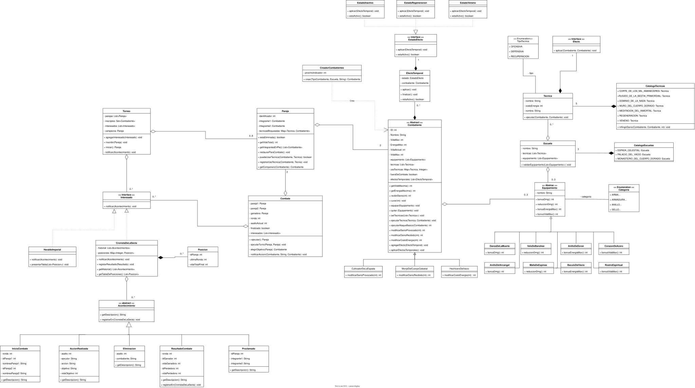

# ⚔️ El Torneo de los Inmortales: La Elección de los Dos Santos Supremos

---

## 📜 Descripción del Proyecto
Este software simula **El Torneo de los Inmortales**, una competencia eliminatoria donde parejas de cultivadores pertenecientes a distintas escuelas se enfrentan en duelos tácticos por turnos. El objetivo principal es consagrar a la única pareja victoriosa como los **Dos Santos Supremos**, aplicando de forma rigurosa los conceptos del paradigma de POO: polimorfismo puro, clases abstractas, encapsulamiento, gestión avanzada de colecciones y patrones de diseño (como *Observer* para los acontecimientos).

---

## 👥 Grupo
**Comisión**: 5900 - Viernes Noche. 

**Grupo**: Kappa

**Integrantes**:
- Pereyra Fernando *(Fercho612)*
- Biagio Facundo *(FacundoBiagio)*
- Toloza Facundo *(FacuToloza)*
- Patri Tiago *(jtiagopatri)*
- Lautaro Alejandro Vega *(LauVega17)*
- Omar Vladimir Quispe Rea *(omarqr95)*

---

## 🏛️ Arquitectura y Decisiones de Diseño

- **Polimorfismo sin `instanceof`:** Las diferencias entre tipos de combatientes (*Cultivador de la Espada*, *Monje del Cuerpo Celestial*, *Hechicero del Vacío*) y el impacto de las técnicas se resuelven mediante polimorfismo dinámico. Las técnicas ignoran el subtipo del combatiente, delegando en este último el cálculo del efecto.
- **Patrón Observer:** El combate y el torneo emiten acontecimientos en tiempo real que son capturados de forma desacoplada por suscriptores clave:
  - **Heraldo Imperial:** Único componente autorizado para mostrar información por pantalla (interfaz de consola).
  - **Cronista de la Secta:** Registra el historial detallado de eventos, gestiona las estadísticas y computa la tabla de posiciones final.
- **Patrón Factory Simple:** `CreadorCombatientes` centraliza la creación de combatientes. Dado el tipo, el nombre y la escuela, devuelve un `Combatiente` ya preparado (equipamiento y técnicas iniciales), sin que el cliente conozca la clase concreta ni cómo se arma su preparación. Agregar un tipo nuevo no modifica al torneo.
- **Patrón Strategy:** Cada `Tecnica` recibe su comportamiento como un `Efecto` (interfaz funcional). Agregar una técnica nueva es crear otro objeto con su efecto, sin modificar las existentes.
- **Patrón State:** Cada `EfectoTemporal` delega su comportamiento en un `EstadoEfecto` (`EstadoVeneno`, `EstadoRegeneracion`, `EstadoInactivo`). Al aplicarse, el efecto pasa al estado inactivo y deja de actuar.
---
## 📄Diagrama UML

---
## ⚖️ Reglas del Juego
### Torneos
- Se juega únicamente con **4 u 8 parejas**. Un combatiente no puede inscribirse dos veces ni una pareja registrarse dos veces.
- Los cruces de la primera ronda se arman por orden de inscripción (primera contra segunda, tercera contra cuarta, etc.); en las siguientes, por el orden de los cruces de la ronda anterior.
- El torneo termina cuando queda una sola pareja, cuyos integrantes son proclamados los **Dos Santos Supremos**.

### Combates
- El combate se desarrolla en **asaltos**. En cada asalto, cada pareja juega su turno completo: cada integrante en pie realiza una acción. Empieza la pareja de menor identificador y, dentro de ella, el integrante de menor identificador.
- Al comenzar cada combate, todos los integrantes (incluidos los caídos en combates anteriores) recuperan **vida y energía al máximo**.
- Al comenzar cada asalto, cada combatiente en pie recupera **15 puntos de energía**, sin superar su máximo.
- **Acción:** un ataque básico (**50 de daño**, sin costo y sin límite de usos) o una técnica (requiere energía suficiente y usos restantes).
- **Criterio de elección**, en este orden:
  1. Una técnica de recuperación si le falta vida.
  2. Una defensiva si no tiene una activa.
  3. La técnica ofensiva con más usos restantes.
  4. Si ninguna es posible, ataque básico.

En empate, se elige la primera en el orden de la escuela.
- **Objetivo:** el rival en pie con menos vida actual; en empate, el de menor identificador. Las técnicas defensivas y de recuperación se aplican al ejecutor.
- Al llegar a cero de vida, el combatiente queda **fuera de combate**: no actúa ni puede ser objetivo. Una pareja pierde cuando sus dos integrantes quedan fuera de combate.
- **Regla del compañero:** cuando un integrante usa una técnica, su compañero no puede usarla mientras el primero conserve usos de ella y siga en pie. La restricción termina con el combate.
- **Usos:** cada combatiente puede usar cada técnica **5 veces en todo el torneo**; el registro no se reinicia entre combates.
- **Límite de asaltos:** **30**. Al alcanzarlo gana la pareja con más vida total (un caído suma cero); en empate, la de menor identificador.
- **Reproducibilidad:** el combate es determinista; ante el mismo estado inicial produce el mismo resultado.

### Combatientes 
- **Cultivador de la Espada**: Guerrero de disciplina férrea que forja su cuerpo y su voluntad a través del filo. Su maestría con las armas potencia cada golpe: **inflige más daño** del que corresponde a la técnica base. **Estadísticas Base**: 1000 HP, 150 EP.
- **Monje del Cuerpo Celestial**: Asceta que ha templado su carne hasta volverla casi indestructible. Su resistencia lo vuelve el pilar de la pareja: **reduce el daño que recibe**. **Estadísticas Base**: 1300 HP, 120 EP.
- **Hechicero del Vacío**: Estudioso de la energía primordial que domina el flujo del qi con una eficiencia sobrenatural. Su control le permite **gastar menos energía** al ejecutar técnicas. **Estadísticas Base**: 800 HP, 230 EP.

### Escuelas
| Escuela | Filosofía | Técnicas iniciales | Equipamiento inicial |
|---|---|---|---|
| **Escuela de la Espada Celestial** | Ataques físicos y armas | Corte de los Mil Amaneceres, Rugido de la Bestia Primordial | Danza de la Muerte |
| **Palacio del Vacío** | Técnicas especiales y dominio de la energía | Dominio de la Nada, Corte de los Mil Amaneceres, Veneno | Anillo de Doran |
| **Monasterio del Cuerpo Dorado** | Resistencia, defensa y recuperación | Muro del Cuerpo Dorado, Meditación del Inmortal, Regeneración | Corazón de Acero, Velo de Banshee |

### Equipamiento
Cada combatiente puede llevar **hasta 3 objetos**, sin dos de la misma categoría (arma, armadura, anillo, sello). Los efectos se acumulan. Equipar un objeto que aumenta un máximo no aumenta el valor actual; al quitarlo, el valor actual se recorta al nuevo máximo si lo supera.
- Armas:
  - **Danza de la Muerte**: Aumenta 50 puntos el daño realizado.
  - **Baculo del Vacio**: Aumenta 100 puntos de energía máxima.
- Armaduras:
  - **Corazón de Acero**: Aumenta 300 puntos de vida máxima.
  - **Malla de Espinas**: Reduce 10 puntos el daño recibido.
- Anillos:
  - **Anillo de Doran**: Aumenta 30 la energía máxima.
  - **Anillo de Arcangel**: Aumenta 10 puntos el daño realizado. 
- Sellos:
  - **Velo de Banshee**: Reduce 20 puntos el daño recibido.
  - **Rostro Espiritual**: Aumenta 150 puntos de vida máxima.

### Técnicas
Una técnica es únicamente su definición (nombre, costo de energía y efecto); los usos se registran en cada combatiente. El daño ofensivo se suma al bonus del equipamiento y luego lo modifican el tipo del ejecutor y el del objetivo.

| Técnica | Tipo | Costo | Efecto | Justificación |
|---|---|---|---|---|
| **Corte de los Mil Amaneceres** | Ofensiva | 30 | 100 de daño | El doble del ataque básico; la más eficiente |
| **Rugido de la Bestia Primordial** | Ofensiva | 70 | 220 de daño | El mayor daño total, pero menos eficiente y lenta de recuperar |
| **Dominio de la Nada** | Ofensiva | 60 | 80 de daño y quita 40 de energía | Menos daño directo, pero deja al rival sin recursos para sus técnicas. |
| **Muro del Cuerpo Dorado** | Defensiva | 40 | −30 de daño recibido por golpe, durante el resto del combate | Anula más de la mitad de un ataque básico, a cambio de un turno sin atacar. |
| **Meditación del Inmortal** | Recuperación | 50 | Cura 150 de vida | Recupera vida base. |
| **Veneno** | Ofensiva | 40 | Aplica un efecto de veneno al rival | Ver *Bonus*. |
| **Regeneración** | Recuperación | 40 | Aplica un efecto de regeneración al ejecutor | Ver *Bonus*. |

---
## ✨ Bonus: Efectos Temporales
Se implementó el bonus de **efectos temporales** con el patrón State:
- **Veneno:** Al comienzo de su siguiente acción, el combatiente afectado recibe **40 de daño** (modificado por su tipo y su equipamiento). Si el veneno lo deja fuera de combate, no actúa.
- **Regeneración:** Al comienzo de su siguiente acción, el combatiente recupera **40 de vida**, sin superar su máximo.
- **Duración:** El efecto actúa una vez y pasa al estado inactivo.
- **Restricción:** Un combatiente no puede recibir un nuevo efecto mientras tenga uno activo.
